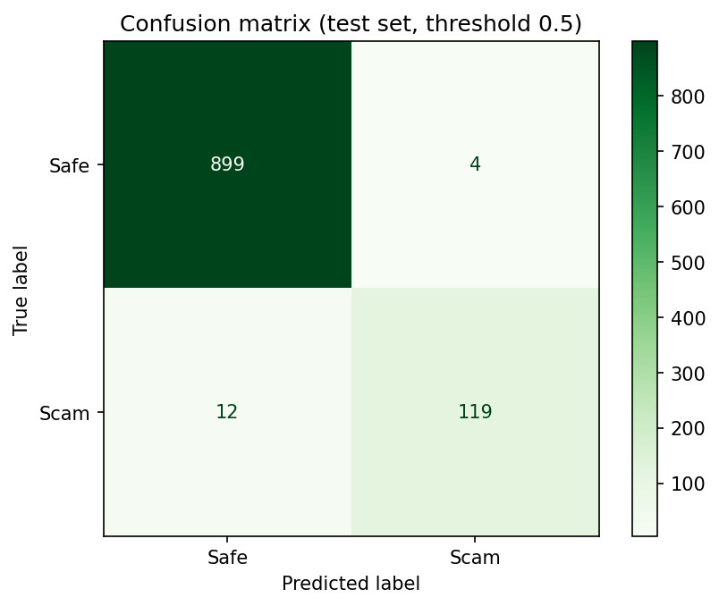

# 🛡️ Veridex AI

**Verify the claim. Before you trust the story.**

**Live demo:** https://veridex-ai-uauuft7zp7xfhwrfghmakw.streamlit.app/
**Hackathon:** ForgeHacks 2026 · Track: **AI + Cybersecurity**

---

## The problem

Scams are getting more convincing: impersonated banks, fake job offers, fake delivery fees, "family member in trouble" messages. Most scam detectors only answer **"scam or safe?"**. That is not enough for an ordinary person who is being pressured to act within minutes. They need to know **why** something is suspicious, **which claims** can't be trusted, **what to check**, and **what to do next**.

## What Veridex does

Veridex is a decision-support tool. You paste a suspicious message or link, and instead of a single label it walks you through:

```
Suspicious content → Claims → Manipulation tactics → Evidence gaps
→ Verification steps → Explainable risk score → Safe action plan
```

The core idea: **CLAIM → EVIDENCE → VERIFICATION → SAFE DECISION**

### Results page

1. **Risk level and score** with a gauge
2. **Why this score**: every point of risk is traced to a named factor (no black-box percentage)
3. **How you're being pushed**: the likely manipulation sequence (e.g. Authority → Fear → Urgency → Financial action)
4. **Claims and evidence**: each claim is extracted and marked **UNVERIFIED** when the message gives no independent evidence
5. **Link check**: red flags such as no HTTPS, raw IP addresses, shortened links, throwaway domain endings, look-alike characters
6. **What should you verify?**: steps that always use an *independent channel* (the official app, the number on your card), never contact details from the message itself
7. **Legitimacy checklist**: "What would need to be true for this to be legitimate?" If it can't be confirmed, do not act
8. **Do / Don't** action plan, including India's reporting route (cybercrime.gov.in, helpline 1930)

Veridex never claims certainty. It says things like: *"This interaction contains multiple high-risk indicators and could not be independently verified."*

## How it works

| Component | What it does |
|---|---|
| Rule-based engine (`engine.py`) | Detects 7 manipulation tactics (authority impersonation, fear/threat, urgency, secrecy, credential/OTP requests, financial action, reward/lure), extracts claims, checks links, and builds the explainable score from weighted factors |
| ML classifier (`train.py`, `model.joblib`) | TF-IDF (1–2 word n-grams) + logistic regression, trained on a public SMS dataset; shown as a **second opinion** next to the rule-based score |
| Streamlit app (`app.py`) | The interface and results dashboard |

The ML probability is mapped to three bands: Safe (<30%), Suspicious (30–70%), High-risk (>70%). The model itself is trained as a binary classifier (spam vs. not spam); the three bands are a mapping on its probability, not a trained 3-class model.

## Dataset

**SMS Spam Collection** (UCI Machine Learning Repository), obtained via Kaggle: https://www.kaggle.com/datasets/uciml/sms-spam-collection-dataset

5,572 messages in the raw file; 5,169 remain after removing duplicates (4,135 train / 1,034 test, stratified split, random seed 42). No data was fabricated or synthetically generated.

## Results (held-out test set, 1,034 messages)

| Threshold | Accuracy | Precision | Recall | F1 | False negatives (missed scams) | False positives |
|---|---|---|---|---|---|---|
| 0.5 | 98.5% | 96.7% | 90.8% | 93.7% | 12 | 4 |
| 0.3 | 97.5% | 87.2% | 93.9% | 90.4% | 8 | 18 |

In cybersecurity, a **missed scam (false negative)** is usually worse than a false alarm, so lowering the threshold to 0.3 trades some precision for fewer missed scams.



*Confusion matrix at threshold 0.5: 899 true safe, 4 false alarms, 12 missed scams, 119 caught scams.* Full numbers are in `metrics.json`.

## What works and what doesn't

**Works**
- Rule-based claim extraction, tactic detection, explainable scoring, link checks, verification steps, checklist and action plan
- The ML classifier loads and runs inside the app and reports honest test-set metrics

**Limitations (please read)**
- The dataset is **general SMS spam**, mostly not bank, UPI, job or government-impersonation scams. The classifier can therefore give **low scores to real scams** that look different from its training data. This is why the rule-based checks run alongside it and why the ML result is labelled a second opinion, not a verdict.
- Rules are keyword and pattern based. New wording or other languages can be missed. **English only.**
- Claim extraction is rule-based (sentence-level); there is no LLM layer yet.
- No screenshot, voice or image input yet.
- Scores are heuristic and not calibrated probabilities.
- Veridex is an awareness and decision-support tool. It **cannot confirm** whether something is or isn't a scam.

## Privacy

Text pasted into the app is analysed in the session and is not stored by the app.

## Run locally

```bash
git clone https://github.com/<your-username>/veridex-ai.git
cd veridex-ai
pip install -r requirements.txt
streamlit run app.py
```

To retrain the model:

```bash
python train.py --data spam.csv
```

## Project files

```
app.py            Streamlit interface
engine.py         Rule-based analysis + ML model loader
train.py          Training and evaluation script
model.joblib      Trained classifier
metrics.json      Test-set metrics
confusion_matrix.png
requirements.txt
.streamlit/config.toml   Theme
```

## Future work

- Train on additional public phishing/fraud datasets, including India-specific scam types (UPI, KYC, fake job, courier/customs)
- LLM-based claim extraction with the rules as an offline fallback
- Screenshot (OCR) input, since many scams arrive as WhatsApp screenshots
- Hindi and Marathi support and a simplified "family mode" for elderly users
- A "I already acted" recovery panel (block card, call 1930, change passwords)

## Use of AI

This project was built during ForgeHacks 2026 with the help of an AI assistant (Claude) for code generation and design, and uses scikit-learn for the classifier. The rule-based engine, the classifier and the Streamlit app all run as described above; the limitations section lists what does not.

## Team

Shruti Jadhav and Aayush Mahadik
